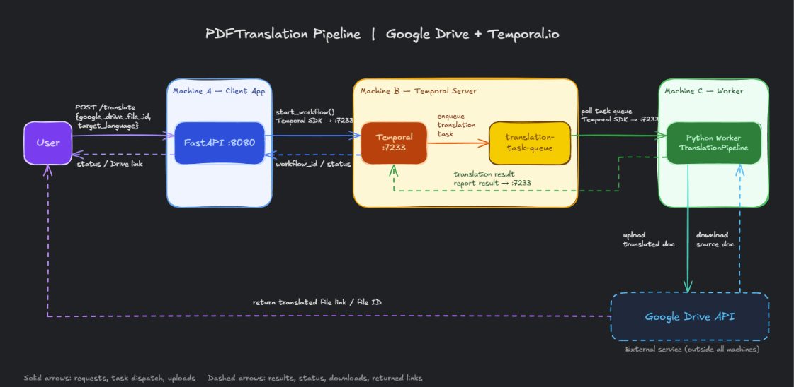

# PDF Translation Workflow with Temporal and Human-in-the-Loop

A workflow-driven system for extracting text from PDF files stored in Google Drive, translating the content into Arabic, and routing the result through a human review process before final approval.

## Overview

This project is designed for organizations that keep contract, policy, research, or operational PDFs in Google Drive and need a repeatable, auditable translation pipeline. Instead of translating documents manually, the system automates the ETL-like flow from document ingestion to translated output while preserving reviewability and operational traceability.

The solution combines:

- Google Drive document access
- PDF parsing and text extraction
- Temporal orchestration for durable workflows and retries
- LLM-based translation
- Human review and approval cycles

The result is a more scalable and controlled translation process that reduces repetitive work while keeping quality review in the loop.

## Why Temporal?

Temporal is used to manage long-running workflows with strong failure handling, retries, and workflow observability. In this project, it is responsible for orchestrating the sequence of work that spans document download, extraction, translation, and human review.

This helps the system manage:

- retries for failed PDF extraction or translation tasks
- state tracking across workflow stages
- review checkpoints and approval decisions
- long-running execution without manual coordination
- operational visibility through the Temporal UI

## Human-in-the-Loop Design

The workflow does not assume AI output is final. A reviewer is included in the process to validate quality, improve accuracy, and decide whether the translation should be accepted or revised.

Typical flow:

1. A PDF is uploaded or selected in Google Drive.
2. The workflow is started in Temporal.
3. The document is downloaded and text is extracted.
4. Extracted content is translated into Arabic.
5. The result is reviewed by a human reviewer.
6. The reviewer approves or requests revision.
7. The final approved output is saved and tracked.

This hybrid model balances automation, speed, and domain-specific quality control.

## High-Level Workflow

```text
Google Drive PDF
      |
      v
Temporal Workflow
      |
      +--> Download file
      |
      +--> Extract PDF text
      |
      +--> Translate to Arabic
      |
      +--> Human review / revision
      |
      +--> Approve final result
      |
      +--> Track workflow state and outcomes
```

## System Design



This system uses Google Drive as the document source and Temporal as the orchestration layer for durable execution. A worker downloads the PDF, extracts the content, forwards the text to the translation service, and routes the result through a reviewer approval loop. The architecture is designed to make every stage observable, reviewable, and resilient to transient failures.

## Core Features

- PDF ingestion from Google Drive
- Text extraction from PDF documents
- Arabic translation workflow orchestration
- Retry and failure handling through Temporal
- Human validation and revision support
- Workflow state tracking and monitoring
- Auditable processing flow for review and quality control

## Suggested Architecture

- Google Drive API for file discovery and access
- Temporal worker for workflow orchestration and execution
- PDF parsing and text extraction layer
- LLM or translation service for Arabic translation
- FastAPI endpoint layer for workflow triggers and status checks
- Review interface for human approval or revision
- Storage for downloaded PDFs, extracted content, and final outputs

## Example Workflow States

- Pending
- Downloaded
- Text extracted
- Translation started
- Translation completed
- Awaiting human review
- Approved
- Rejected
- Completed
- Failed

## Tech Stack

- Python
- Temporal SDK
- Google Drive API
- PyMuPDF / PDF extraction tooling
- OpenRouter or LLM-based translation service
- FastAPI
- PostgreSQL or other durable metadata store (optional for future extension)

## Project Structure

```text
pdf-translation/
├── README.md
├── requirements.txt
├── src/
│   ├── ai-workflow/
│   │   ├── activities.py
│   │   ├── child_workflow.py
│   │   ├── helpers.py
│   │   ├── parent_workflow.py
│   │   ├── prompts.py
│   │   ├── worker.py
│   │   └── .env
│   ├── client-app/
│   │   ├── main.py
│   │   └── .env
│   └── pdf-to-md/
│       ├── download_pdf.py
│       ├── helpers.py
│       └── workflow_process.py
└── assets/
```

## Local Setup

### 1. Clone the repository

```bash
git clone https://github.com/EyadAmgad/pdf-translation.git
cd pdf-translation
```

### 2. Create environment variables

Copy the example environment file and fill in your own values:

```bash
cp src/ai-workflow/.env.example src/ai-workflow/.env
cp src/client-app/.env.example src/client-app/.env
```

At minimum, configure:

- Google Drive credentials or API key
- OpenRouter API key
- Temporal host and namespace
- task queue values

### 3. Install dependencies

```bash
conda activate pdf-translation
pip install -r requirements.txt
```

## Running the Application

### Start Temporal

Open a terminal and run:

```bash
temporal server start-dev
```

### Start the worker

In a second terminal:

```bash
cd src/ai-workflow
python worker.py
```

### Start the FastAPI app

In another terminal:

```bash
cd src/client-app
uvicorn main:app --host 0.0.0.0 --port 8080 --reload
```

### Trigger the review workflow

```bash
curl -X POST http://localhost:8080/translation-review/start \
  -H "Content-Type: application/json" \
  -d '{
    "file_paths": [
      "https://drive.google.com/file/d/FILE_ID/view?usp=drive_link",
      "https://drive.google.com/file/d/FILE_ID_2/view?usp=drive_link"
    ],
    "max_concurrent_translations": 3
  }'
```

### Check workflow status

```bash
curl http://localhost:8080/translation-review/<WORKFLOW_ID>/status
```

### Assign a reviewer

```bash
curl -X POST http://localhost:8080/translation-review/<WORKFLOW_ID>/assign \
  -H "Content-Type: application/json" \
  -d '{"name": "reviewer-name"}'
```

### Request revision

```bash
curl -X POST http://localhost:8080/translation-review/<WORKFLOW_ID>/revise \
  -H "Content-Type: application/json" \
  -d '{"feedback": "Please improve the wording and preserve legal terminology."}'
```

### Approve the workflow

```bash
curl http://localhost:8080/translation-review/<WORKFLOW_ID>/approve
```

### Temporal UI

The Temporal UI is typically available at:

```text
http://localhost:8233
```

## Project Goals

This project aims to:

- reduce the manual effort required to translate PDF documents
- create a reliable workflow for document extraction and translation
- improve consistency and speed across translation tasks
- integrate AI-generated translation with human review and oversight
- support scalable orchestration for document processing pipelines
- make translation quality easier to audit and validate

## Future Enhancements

- support multiple target languages
- improve layout-aware extraction for complex PDFs
- add file versioning and metadata tracking in Drive
- integrate analytics for translation quality and reviewer feedback
- enable automatic routing or prioritization by document type or urgency
- add durable storage for approved final outputs

## License

This project is intended for internal, experimental, or research-oriented use unless otherwise specified.

## Notes

This README acts as a project overview and onboarding guide. As the system evolves, the architecture, API surface, and workflow details may be expanded to reflect production deployment requirements.
